# TaskFlow - To-Do List App

A responsive To-Do List web application built with **Flutter** and **Dart**.

**Live demo:** https://codemaster917.github.io/taskflow/

**Source code:** https://github.com/codemaster917/taskflow

**Author:** B. Kirthan Choudhary

## Features

- Dashboard with total, completed and pending task counts
- Add, edit and delete tasks
- Mark tasks as completed
- Separate Pending and Completed sections
- Task details screen
- Search and filter (All / Pending / Completed)
- Form validation (title is required, at least 3 characters, due date is required)
- Light and dark themes
- Tasks stay saved after refreshing the browser (local storage)

## Flutter concepts used

| Concept | How it is used |
|---|---|
| Widgets | Container, Row, Column, Stack, ListView, GridView, Card, buttons |
| Responsive UI | MediaQuery: 1 column on mobile, 2 on tablet, 3 on desktop |
| Navigation | Named routes with Navigator.pushNamed |
| Animations | Hero, AnimatedContainer, TweenAnimationBuilder, page transitions |
| State management | StatefulWidget, setState and Provider |
| Themes and custom widgets | AppTheme (light and dark), TaskCard, StatCard, PriorityBadge, EmptyState |
| Forms and validation | Form, TextFormField, validators, date picker |

## Project structure

- `lib/models` - Task model
- `lib/providers` - TaskProvider and ThemeProvider
- `lib/screens` - Home, Add/Edit Task and Task Details screens
- `lib/widgets` - reusable custom widgets
- `lib/theme` - app theme
- `lib/utils` - responsive and date helpers

## Packages used

- `provider` for state management
- `shared_preferences` for saving tasks in the browser

## Run locally

1. Install Flutter
2. Run `flutter pub get`
3. Run `flutter run -d chrome`

## Screenshots

### Home (desktop)
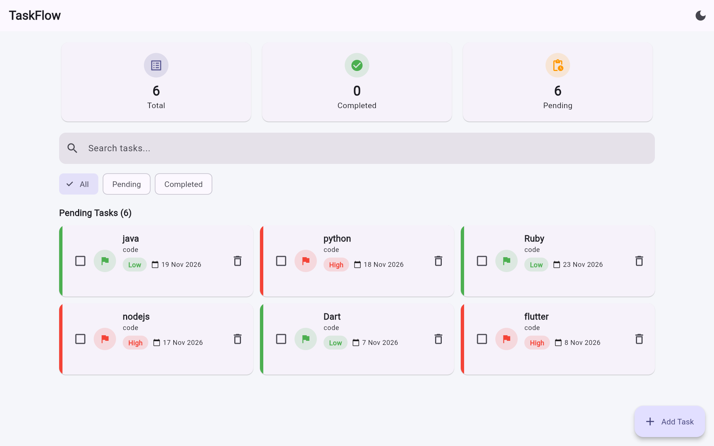

### Home (dark mode)
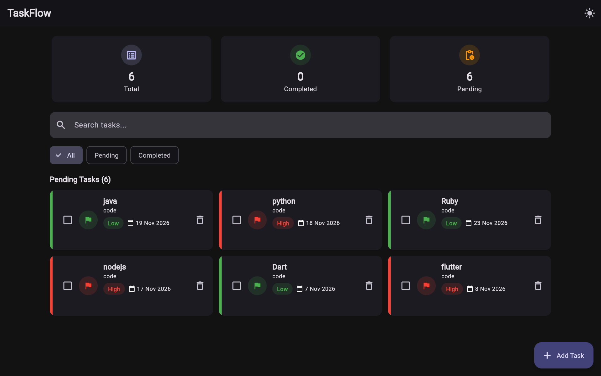

### Tablet view
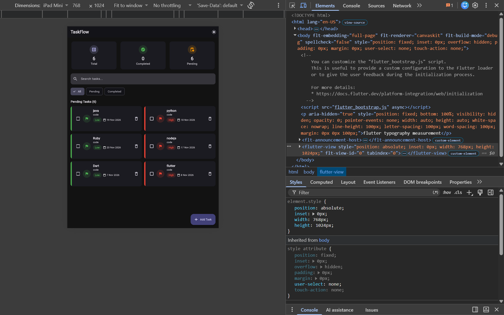

### Mobile view
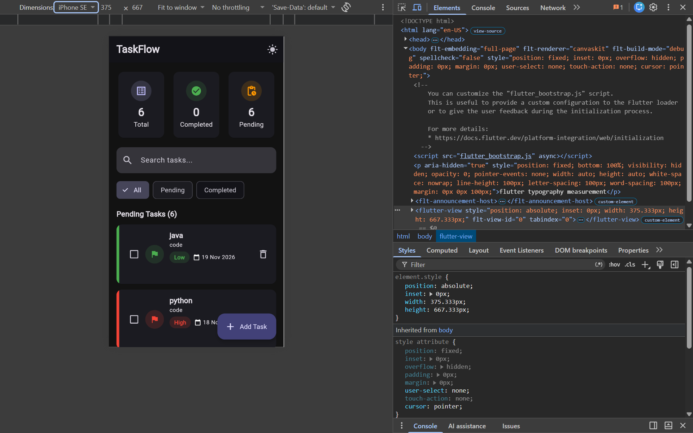

### Form validation
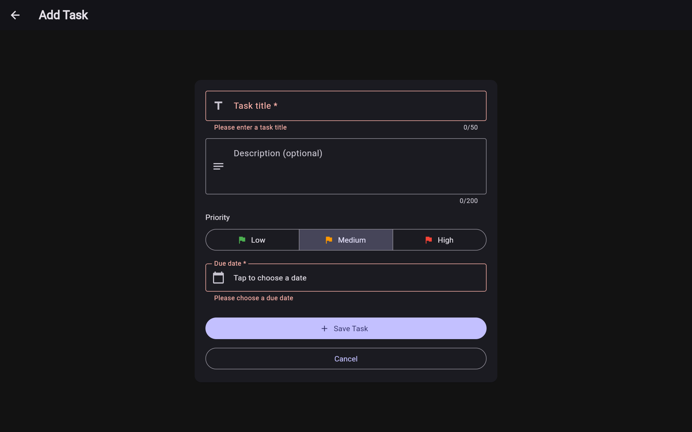

### Add task
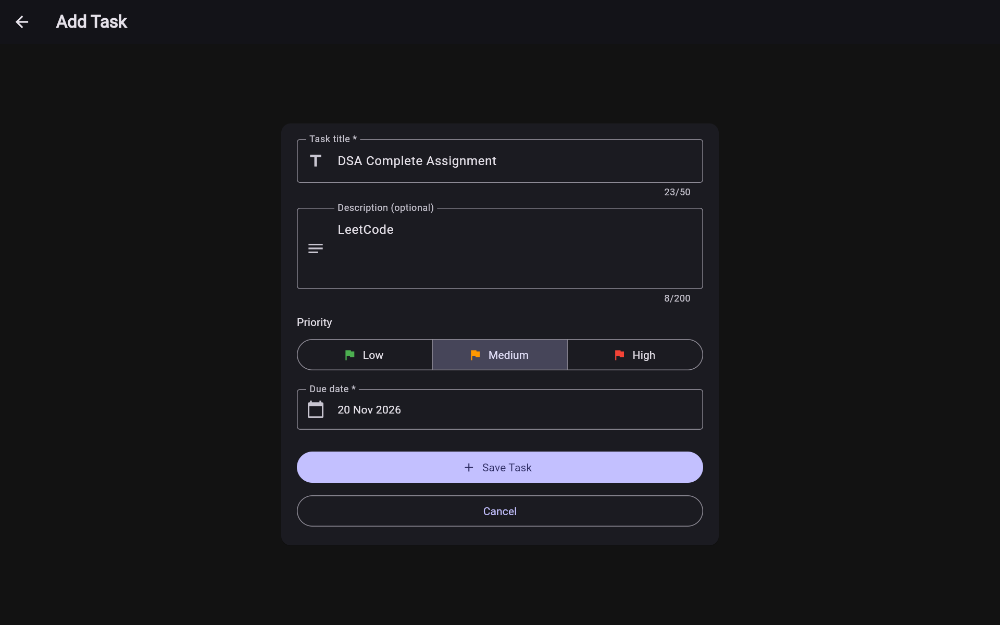

### Edit task
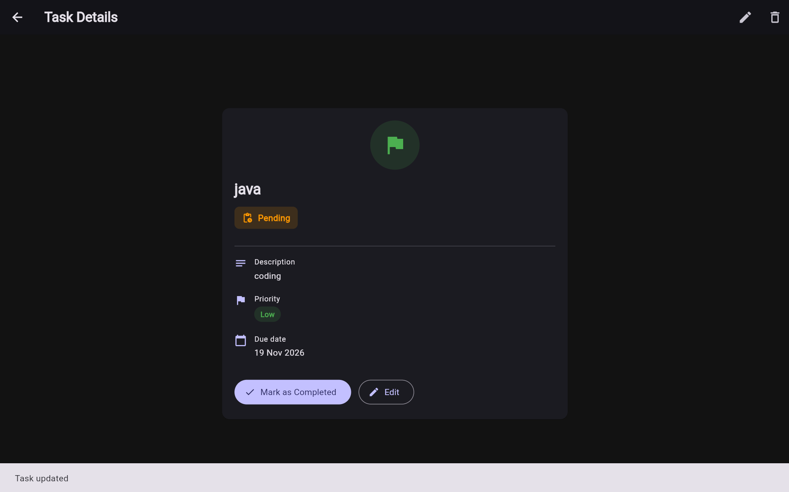

### Task details
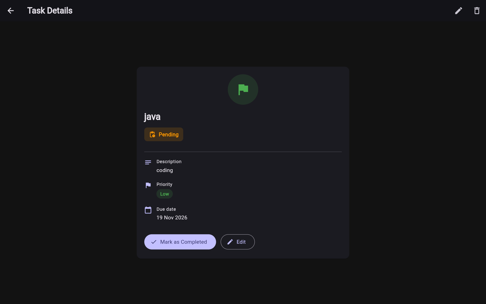

### Delete confirmation
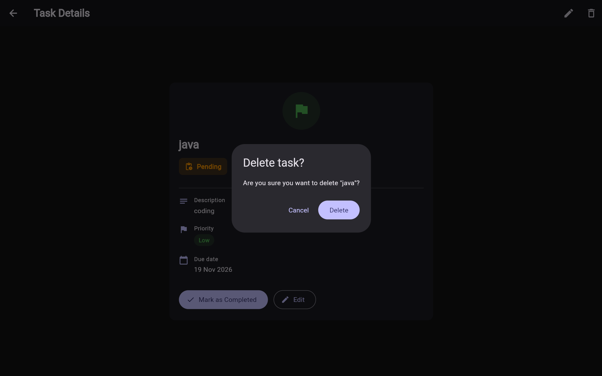

### Search
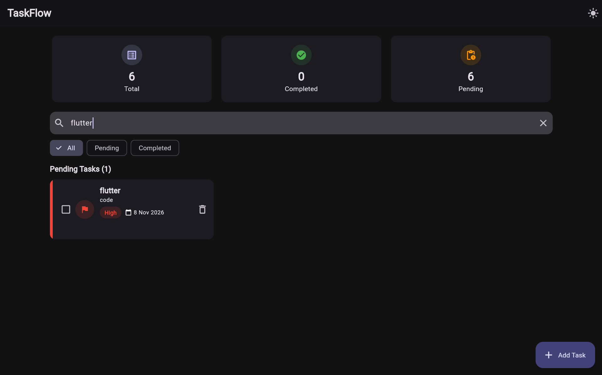

### Filter
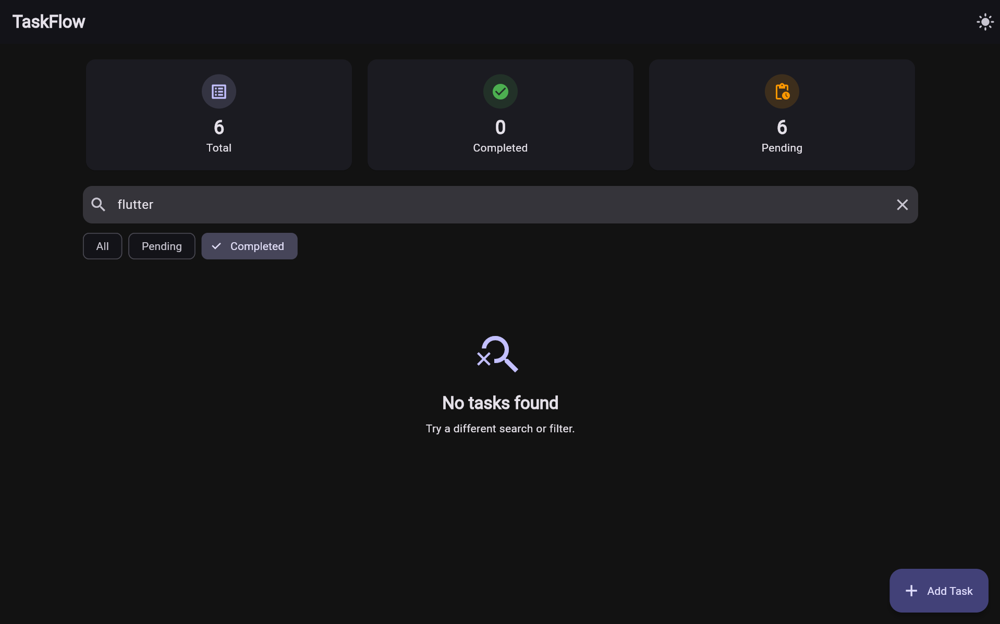